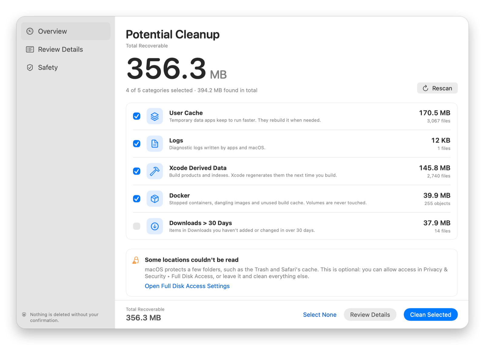
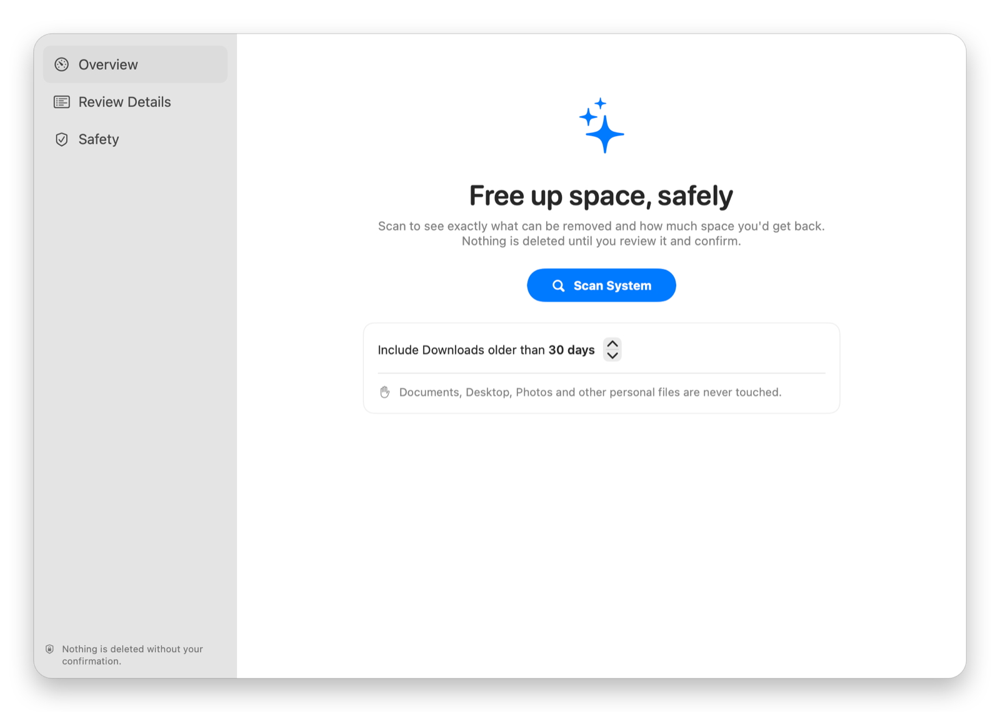
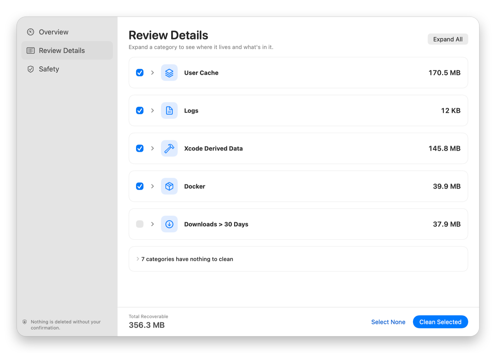

<div align="center">


# Mac Cleanup Assistant

**Find what's taking up space. Review every item. Nothing is removed until you confirm.**

A native SwiftUI utility for macOS that scans well-known cleanup locations, shows exactly what it found, and cleans only what you approve.

[](https://github.com/supunsarachitha/MacCleanup/actions/workflows/swift.yml)
[](https://github.com/supunsarachitha/MacCleanup/releases/latest)


[**Download**](https://github.com/supunsarachitha/MacCleanup/releases/latest) ·
[Project site](https://supunsarachitha.github.io/MacCleanup/) ·
[Report an issue](https://github.com/supunsarachitha/MacCleanup/issues)

</div>

<br>



---

## Highlights

- **Read-only scan.** Scanning lists folders and reads file attributes. It has no code path that changes anything.
- **Review before you delete.** Every category shows its location, size, file count and a short preview.
- **Explicit confirmation.** A dialog shows the exact size, category count and file count. Nothing happens until you press **Delete**.
- **Safety policy, checked twice.** Protected folders and system locations are refused at scan time and again immediately before each removal.
- **Your own files go to the Trash.** Downloads and Xcode Archives are moved to the Trash, so a mistake can be undone.
- **Native and private.** Pure SwiftUI, no third-party dependencies, no network access.

## Screenshots

<table>
  <tr>
    <td width="50%"></td>
    <td width="50%"></td>
  </tr>
  <tr>
    <td align="center"><sub><b>Scan</b>: read-only, nothing changes</sub></td>
    <td align="center"><sub><b>Review</b>: expand any category, choose what to clean</sub></td>
  </tr>
</table>

<sub>Screenshots show a scan of a developer Mac; your sizes and categories will differ.</sub>

## Install

### Download the app

1. Download **Mac-Cleanup-Assistant.dmg** from the [latest release](https://github.com/supunsarachitha/MacCleanup/releases/latest).
2. Open the DMG and drag **Mac Cleanup Assistant** to **Applications**.
3. On first launch, right-click the app and choose **Open**.

> [!NOTE]
> The released build is ad-hoc signed and not notarized, so macOS Gatekeeper asks you to confirm the first launch. If the app is blocked, open **System Settings → Privacy & Security** and choose **Open Anyway**. If you'd rather not run an unnotarized binary, build it from source below.

### Build from source

Requirements: macOS 14 Sonoma or newer and Xcode 16 or newer.

**In Xcode**

1. Open `MacCleanup.xcodeproj`.
2. Select the **MacCleanup** scheme and **My Mac**.
3. Press **⌘R**.

**From the terminal**

```sh
# Build
xcodebuild -project MacCleanup.xcodeproj -scheme MacCleanup -configuration Release build

# Test
xcodebuild -project MacCleanup.xcodeproj -scheme MacCleanup -destination 'platform=macOS' test

# Build a drag-to-Applications installer (writes build/installer/Mac-Cleanup-Assistant.dmg)
./scripts/build-installer.sh
```

The project is ad-hoc signed (`CODE_SIGN_IDENTITY = -`), which is enough to run it on the Mac that built it. To distribute your own build, set your team and signing identity in **Signing & Capabilities** and notarize the app.

## How it works

```
Scan  →  Review  →  Select  →  Confirm  →  Clean  →  Results
```

| Step | What happens |
|---|---|
| **Scan** | **Scan System** (⌘R) reads the cleanup locations and measures them. Nothing is changed. |
| **Review** | The summary lists each category with its size and file count, plus the total you'd recover. **Review Details** expands every category into its location and a short preview (never thousands of rows). |
| **Select** | Every category has a checkbox. Items that are your own files (Downloads, Xcode Archives) start unchecked. |
| **Confirm** | **Clean Selected** opens a dialog with the size, category count and file count. Nothing is removed until **Delete** is pressed. |
| **Clean** | Cleanup runs with live progress and a **Stop** button. |
| **Results** | The results screen reports space recovered, files removed and time taken. |

## Cleanup categories

| Category | Location | How it's cleaned |
|---|---|---|
| User Cache | `~/Library/Caches` (minus the browser and Homebrew folders below) | Deleted |
| Logs | `~/Library/Logs` | Deleted |
| Temporary Files | `/private/tmp`, `/private/var/tmp`: your own items untouched for 3+ days | Deleted |
| Safari Cache | `~/Library/Caches/com.apple.Safari` | Deleted |
| Chrome Cache | `~/Library/Caches/Google/Chrome` | Deleted |
| Firefox Cache | `~/Library/Caches/Firefox/Profiles` | Deleted |
| Trash | `~/.Trash` | Deleted |
| Xcode Derived Data | `~/Library/Developer/Xcode/DerivedData` | Deleted |
| Xcode Archives | `~/Library/Developer/Xcode/Archives` | **Moved to Trash** |
| Homebrew Downloads | `~/Library/Caches/Homebrew/downloads` and `/Cask` | Deleted |
| Docker | Stopped containers, dangling images, unused build cache | `docker … prune` |
| Downloads older than N days | `~/Downloads` (N is 30 by default; change it in Settings) | **Moved to Trash** |

Only the *direct children* of those folders are removed; the folders themselves stay. Sizes are allocated disk space, which is what you actually get back. Docker figures are estimates reported by the Docker CLI.

## Safety

| Guarantee | How |
|---|---|
| **Scan is read-only** | `ScanManager` only lists folders and reads file attributes. |
| **Two-step removal** | `CleanupManager` starts only from the confirmation dialog's **Delete** button. |
| **Policy checked twice** | `SafetyPolicy` runs at scan time and again right before each item is removed. It refuses anything that isn't a direct child of the category's folder, anything inside Desktop, Documents, Pictures, Movies, Music, iCloud Drive, Mail, Messages, Keychains or Application Support, any Photos/Music/TV/Final Cut library, and system locations. |
| **Symlinks are never followed** | A link inside a cache can't lead the cleanup into your documents. |
| **Stale items are skipped** | Downloads and temp files are re-checked right before removal; anything modified since the scan is left alone. |
| **Reversible for your files** | Downloads and Xcode Archives are moved to the Trash. |
| **Docker volumes are never pruned** | Only containers, dangling images and build cache are considered. |
| **Failures don't abort the run** | Problems are reported per item. |

### Permissions and sandboxing

A disk cleaner has to read and delete files across the user's Library, so the App Sandbox is intentionally **off** (a sandboxed app can only touch its own container). Release builds enable the Hardened Runtime. The app requests no permissions up front.

Two macOS-protected locations (the Trash and Safari's cache) can only be read with **Full Disk Access**. That's optional: without it those rows show "Needs Full Disk Access" and everything else works. The first scan of Downloads triggers macOS's standard "Downloads folder" prompt.

## Project structure

```
MacCleanup/
├── App/MacCleanupApp.swift          Entry point, window, Cleanup menu, Settings scene
├── Models/
│   ├── FileCategory.swift           What a category is (data, not behaviour)
│   ├── ItemFilter.swift             Which children of a folder qualify
│   ├── ScanResult.swift             ScannedItem, SampleEntry, CategoryScanResult
│   └── CleanupResult.swift          CleanupProgress, CleanupFailure, CleanupResult
├── Services/
│   ├── CategoryCatalog.swift        The list of categories (add new ones here)
│   ├── ScanManager.swift            Read-only concurrent scan
│   ├── CleanupManager.swift         Confirmed removal with progress
│   ├── StorageAnalyzer.swift        Disk-usage measurement
│   ├── SafetyPolicy.swift           What may never be removed
│   └── DockerService.swift          Docker CLI estimate and prune
├── ViewModels/CleanupViewModel.swift  Workflow state machine (MVVM)
├── Views/                           SwiftUI screens and components
└── Support/                         Byte/duration formatting, CommandRunner
MacCleanupTests/CleanupEngineTests.swift
```

## Contributing

Issues and pull requests are welcome. Before opening a pull request, run the test suite (see [Build from source](#build-from-source)); CI runs the same build and tests on every push and pull request.

### Adding a category

1. Add a case to `FileCategory.ID`.
2. Add one `FileCategory(...)` entry to `CategoryCatalog.categories(configuration:)` with its folder(s), a filter, and a disposal (`deletePermanently` or `moveToTrash`).

The scan, cleanup, safety checks, summary and review screens pick it up with no further changes. `CleanupEngineTests` asserts that no catalog entry points at a protected location.

## Known limitations

- Homebrew uses `~/Library/Caches/Homebrew`; a custom `HOMEBREW_CACHE` isn't detected.
- Only the current user's Trash is emptied, not per-volume trashes.
- Docker Desktop may not shrink its disk image immediately after a prune.
